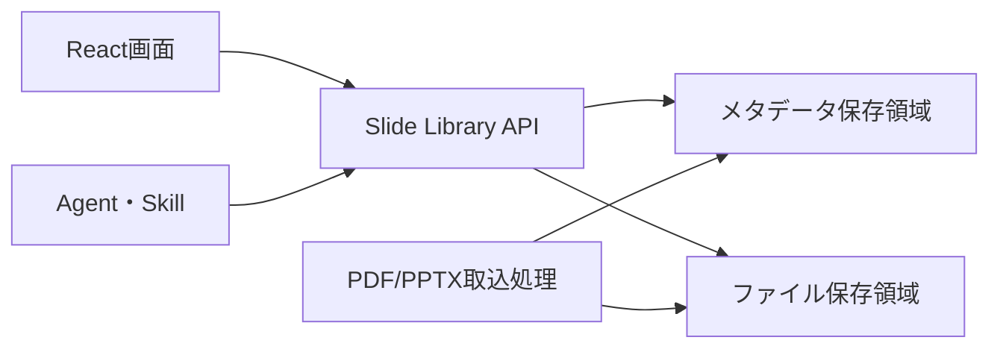

# 基本設計

## 構成

フロントエンドはReact/Vite・TypeScript、バックエンドはPython/FastAPIで構成する。フロントエンドはHTTP API経由で一覧・詳細を表示する。

最初は単一のバックエンドとし、検索処理をAPI側に置く。フロントエンドは検索条件を送って結果を表示する。

ローカル開発環境ではDocker Composeでフロントエンドとバックエンドを起動する。フロントエンドだけをホストの `127.0.0.1:3000` に公開し、`/api` をバックエンドへ中継する。バックエンドはホストにポートを公開しない。エージェントも同じSlide Library APIから検索・詳細情報を取得する。APIは一覧・検索で軽い概要を返し、解析情報や元ファイルは必要なページ・資料について個別に取得する。エージェント専用のバックエンドは設けない。

## フェーズ1の範囲

- PDF/PPTXの登録、保存、ページ画像化とメタデータ管理
- ページ一覧・詳細を返すAPIと、文字列・著者・タグ・元フォルダによる簡単な絞り込み
- 一覧・詳細画面と、検索結果がない場合の表示

Google Drive連携やEmbedding検索は後続段階で扱う。実ファイルを使う前に、配信先の到達範囲と元資料の共有条件を確認する。

## ブラウザからのアクセスと更新系API

初期運用は、到達を認められた研究室メンバー全員が資料を閲覧・登録・編集できる共有ライブラリとする。アプリ内の利用者アカウントや資料ごとの権限判定は設けず、配信先の到達範囲を運用で制限する。接続経路や内部ネットワークの手順は公開リポジトリに記載しない。異なる共有範囲の資料を扱う場合は、資料単位の権限設計を改めて行う。

画面とAPIは同一オリジンで提供するため、現行構成にCORS許可設定は不要である。CORSは更新リクエストの安全性を保証しない。`POST /api/documents`、`PUT /api/pages/{pageId}/tags`、後続のメタデータ更新・Drive取り込みなどの状態変更APIでは、別サイトからのフォーム送信も含めて拒否できるCSRF対策を実装する。送信元Originの検証とカスタムヘッダーの要求を基本案とし、ブラウザ以外のAPIクライアントとSwagger UIの利用も確認する。GETでは状態を変更しない。[OWASPのCSRF対策ガイド](https://cheatsheetseries.owasp.org/cheatsheets/Cross-Site_Request_Forgery_Prevention_Cheat_Sheet.html)を参照する。

想定外のHostヘッダーを拒否し、アップロードは解析処理へ渡す前のリクエスト受信時にも容量を制限する。現在のファイルサイズ・ページ数・変換時間の上限に加え、連続登録時の保存容量と処理数を確認する。[OWASPのFastAPIセキュリティガイド](https://cheatsheetseries.owasp.org/cheatsheets/FastAPI_Security_Cheat_Sheet.html)を参照する。

## データ処理

PDF/PPTX本体とページのプレビューはファイル用の保存領域、検索対象と元ファイル・ページの対応はメタデータ保存領域に置く。初期実装ではJSONファイルに永続化し、検索・更新量が増えた段階でDBへ移行する。取込処理はページ画像と取得可能な文字列を作り、[データ設計](data-model.md)の資料・ページに関連付ける。PDFと元PPTXが対応する場合も、片方だけ登録される場合も扱えるようにする。

開発環境ではホストの `data/` をAPIコンテナの `/data` にマウントする。手元の資料は `data/imports/` に置き、登録後の元ファイルは `/data/uploads/{documentId}.pdf` または `.pptx`、生成したプレビューは `/data/previews/{documentId}/{pageNumber}.png` に保存する。資料とページのメタデータは `/data/documents.json` と `/data/pages.json` に置き、APIにはホストの絶対パスを返さない。`data/` はGitで管理しない。

Google Drive連携ではフォルダ階層を出典として保持する。フォルダは資料の所属、タグはページの内容・役割として分ける。Embeddingなどの検索用データはページIDに紐づく派生データとして追加する。

## 配信構成

Viteの `/api` プロキシは開発用である。本番ではフロントエンドをビルドした静的ファイルをNginxから配信し、同じオリジンの `/api` をバックエンドに中継する。バックエンドは開発用の自動リロードを無効にする。配信先と永続ストレージが決まる段階で、本番用のコンテナ設定を開発用Composeから分ける。

APIのリクエスト・レスポンスは[API仕様](api.md)、共同開発の進め方と品質確認は[CONTRIBUTING](CONTRIBUTING.md)を参照する。
