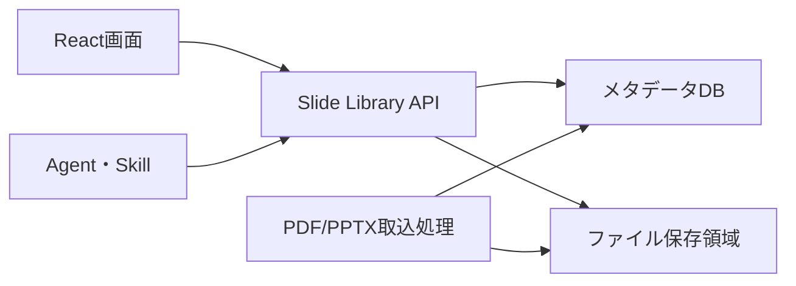

# 基本設計

## 構成

フロントエンドはReact/Vite・TypeScript、バックエンドはPython/FastAPIを第一候補とする。フェーズ1からHTTP APIを置き、フロントエンドはAPI経由で一覧・詳細を表示する。

最初は単一のバックエンドとし、検索処理をAPI側に置く。フロントエンドは検索条件を送って結果を表示する。

ローカル開発環境ではDocker Composeでフロントエンドとバックエンドを起動する。フロントエンドだけをホストの `127.0.0.1:3000` に公開し、`/api` をバックエンドへ中継する。バックエンドはホストにポートを公開しない。エージェントも同じSlide Library APIから検索・詳細情報を取得する。APIは一覧・検索で軽い概要を返し、解析情報や元ファイルは必要なページ・資料について個別に取得する。エージェント専用のバックエンドは設けない。

## フェーズ1の範囲

- PDF/PPTXの登録、保存、ページ画像化とメタデータ管理
- ページ一覧・詳細を返すAPIと、文字列・タグ・元フォルダによる簡単な絞り込み
- 一覧・詳細画面と、検索結果がない場合の表示

Google Drive連携やEmbedding検索は後続段階で扱う。実ファイルを使う前に、登録・閲覧権限と元資料の共有条件を設計する。

## ブラウザからのアクセスと更新系API

ローカルホストへのバインドやネットワーク上のアクセス制限だけに、資料の保護を依存させない。実ファイルを扱う前に認証・認可を設け、一覧・詳細・プレビュー・元ファイル取得にも資料ごとの閲覧権限を適用する。

`POST /api/documents` や `PUT /api/pages/{pageId}/tags` などの更新系APIをブラウザから利用する際は、認証方式に合わせてCSRF対策を実装する。Cookieで認証する場合はCSRFトークンの検証を基本とし、送信元Originの確認とCookieの `SameSite` 設定も行う。エージェントの認証方式はブラウザのセッションとは分けて設計する。CORS設定だけをCSRF対策として扱わず、GETでは状態を変更しない。詳細は[OWASPのCSRF対策ガイド](https://cheatsheetseries.owasp.org/cheatsheets/Cross-Site_Request_Forgery_Prevention_Cheat_Sheet.html)を参照する。

## データ処理

PDF/PPTX本体とページのプレビューはファイル用の保存領域、検索対象と元ファイル・ページの対応はDBに置く。取込処理はページ画像と取得可能な文字列を作り、[データ設計](data-model.md)の資料・ページに関連付ける。PDFと元PPTXが対応する場合も、片方だけ登録される場合も扱えるようにする。

Google Drive連携ではフォルダ階層を出典として保持する。フォルダは資料の所属、タグはページの内容・役割として分ける。Embeddingなどの検索用データはページIDに紐づく派生データとして追加する。

APIのリクエスト・レスポンスは[API仕様](api.md)、共同開発の進め方と品質確認は[CONTRIBUTING](CONTRIBUTING.md)を参照する。
