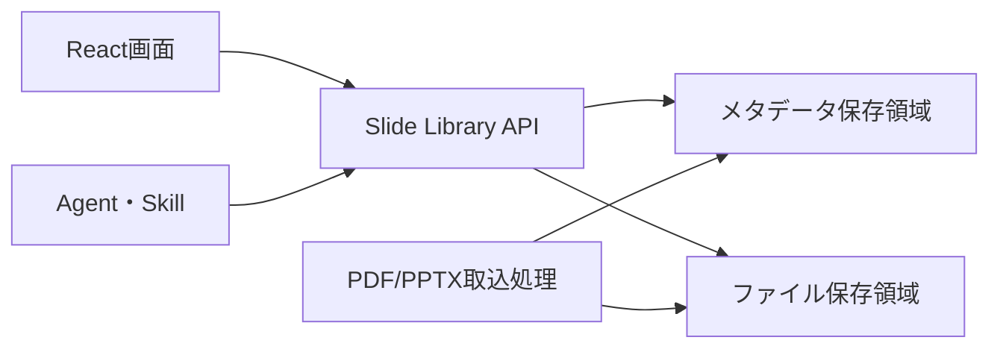

# 基本設計

## 構成

フロントエンドはReact/Vite・TypeScript、バックエンドはPython/FastAPIで構成する。フロントエンドはHTTP API経由で一覧・詳細を表示する。

最初は単一のバックエンドとし、検索処理をAPI側に置く。フロントエンドは検索条件を送って結果を表示する。

ローカル開発環境ではDocker Composeでフロントエンドとバックエンドを起動する。フロントエンドだけをホストの `127.0.0.1:3000` に公開し、`/api` をバックエンドへ中継する。バックエンドはホストにポートを公開しない。エージェントも同じSlide Library APIから検索・詳細情報を取得する。APIは一覧・検索で軽い概要を返し、解析情報や元ファイルは必要なページ・資料について個別に取得する。エージェント専用のバックエンドは設けない。

## フェーズ1の範囲

- PDF/PPTXの登録、保存、ページ画像化とメタデータ管理
- ページ一覧・詳細を返すAPIと、文字列・著者・タグ・元フォルダによる簡単な絞り込み
- 一覧・詳細画面と、検索結果がない場合の表示

Google Drive連携やEmbedding検索は後続段階で扱う。実ファイルを使う前に、登録・閲覧権限と元資料の共有条件を設計する。

## ブラウザからのアクセスと更新系API

初期運用では、承認された研究室メンバー全員が登録済み資料を閲覧できる共有ライブラリとする。資料ごとの閲覧権限は初期対象に含めない。現在のAPIには利用者の認証・権限判定がないため、実資料を扱う前に、一覧・検索・詳細・プレビュー・元ファイル取得と、登録・タグ編集の各APIで、許可された利用者だけが操作できる制御を設けて検証する。異なる共有範囲の資料を扱う段階では、閲覧系APIにも資料ごとの権限判定を追加する。

`POST /api/documents` や `PUT /api/pages/{pageId}/tags` などの更新系APIをブラウザから利用する際は、採用するアクセス制御方式に合わせてCSRF対策を実装する。Cookieで認証する場合はCSRFトークンの検証を基本とし、送信元Originの確認とCookieの `SameSite` 設定も行う。エージェントの認証方式はブラウザのセッションとは分けて設計する。CORS設定だけをCSRF対策として扱わず、GETでは状態を変更しない。詳細は[OWASPのCSRF対策ガイド](https://cheatsheetseries.owasp.org/cheatsheets/Cross-Site_Request_Forgery_Prevention_Cheat_Sheet.html)を参照する。

## データ処理

PDF/PPTX本体とページのプレビューはファイル用の保存領域、検索対象と元ファイル・ページの対応はメタデータ保存領域に置く。初期実装ではJSONファイルに永続化し、検索・更新量が増えた段階でDBへ移行する。取込処理はページ画像と取得可能な文字列を作り、[データ設計](data-model.md)の資料・ページに関連付ける。PDFと元PPTXが対応する場合も、片方だけ登録される場合も扱えるようにする。

開発環境ではホストの `data/` をAPIコンテナの `/data` にマウントする。手元の資料は `data/imports/` に置き、登録後の元ファイルは `/data/uploads/{documentId}.pdf` または `.pptx`、生成したプレビューは `/data/previews/{documentId}/{pageNumber}.png` に保存する。資料とページのメタデータは `/data/documents.json` と `/data/pages.json` に置き、APIにはホストの絶対パスを返さない。`data/` はGitで管理しない。

Google Drive連携ではPDFを保存領域へ取り込み、既存のページ生成・検索処理を共用する。DriveのファイルIDとフォルダIDを出典として保持し、フォルダ名の階層を画面に表示する。資料区分・発表年は資料、スライドの役割とタグはページに保持する。Embeddingなどの検索用データはページIDに紐づく派生データとして追加する。

## 配信構成

Viteの `/api` プロキシは開発用である。本番ではフロントエンドをビルドした静的ファイルをNginxから配信し、同じオリジンの `/api` をバックエンドに中継する。バックエンドは開発用の自動リロードを無効にする。配信先と永続ストレージが決まる段階で、本番用のコンテナ設定を開発用Composeから分ける。

APIのリクエスト・レスポンスは[API仕様](api.md)、共同開発の進め方と品質確認は[CONTRIBUTING](CONTRIBUTING.md)を参照する。
